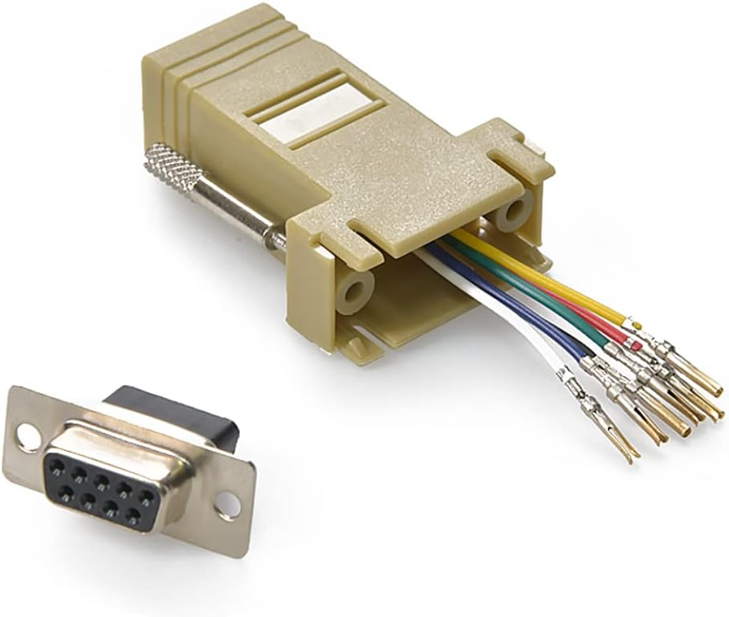
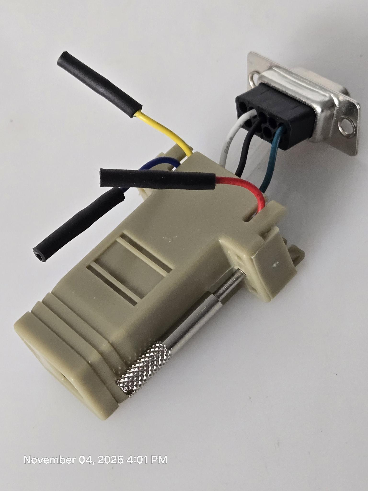

# Renogy RJ12 Pinout

Hardware used: [https://www.amazon.com/dp/B06X9ZJB5R/](https://www.amazon.com/dp/B06X9ZJB5R/)

## DMM Testing Table

<table>
    <thead>
        <th>DMM</th>
        <th>Black</th>
        <th colspan=6>Red</th>
    </thead>
    <tbody>
        <tr>
            <td></td>
            <td>Color</td>
            <td>Red</td>
            <td>Green</td>
            <td>White</td>
            <td>Black</td>
            <td>Blue</td>
            <td>Yellow</td>
        </tr>
        <tr>
            <td rowspan=6>Voltage</td>
            <td>Red</td>
            <td></td>
            <td>0</td>
            <td>-5.78</td>
            <td>0</td>
            <td>12.63</td>
            <td>12.63</td>
        </tr>
        <tr>
            <td>Green</td>
            <td>0</td>
            <td></td>
            <td>-5.78</td>
            <td>0</td>
            <td>12.63</td>
            <td>12.63</td>
        </tr>
        <tr>
            <td>White</td>
            <td>5.78</td>
            <td>5.78</td>
            <td></td>
            <td>5.70</td>
            <td>18.37</td>
            <td>18.37</td>
        </tr>
        <tr>
            <td>Black</td>
            <td>0</td>
            <td>0</td>
            <td>-5.72</td>
            <td></td>
            <td>12.48</td>
            <td>12.41</td>
        </tr>
        <tr>
            <td>Blue</td>
            <td>-12.59</td>
            <td>-12.59</td>
            <td>-18.38</td>
            <td>-12.33</td>
            <td></td>
            <td>0</td>
        </tr>
        <tr>
            <td>Yellow</td>
            <td>-12.61</td>
            <td>-12.61</td>
            <td>-18.38</td>
            <td>-12.45</td>
            <td>0</td>
            <td></td>
        </tr>
    </tbody>
</table>

## Wire Identification

Readings above are the red probe minus the black probe, so each row is a reference wire.

| Wire | Voltage relative to Red | Function |
|---|---|---|
| Red | 0 | GND |
| Green | 0 (same as Red in every row) | GND |
| Black | about 0 V (drifts slightly, undriven input) | RX (controller input) |
| White | -5.78 | TX (controller output, RS-232 idle level) |
| Blue | +12.6 | Power (do not connect) |
| Yellow | +12.6 | Power (do not connect) |

## DB9 Wiring (RS-232)

Pin numbers are for a standard DB9 serial port (DTE, such as a PC COM port), where pin 2 is RXD and pin 3 is TXD. Controller TX goes to the converter's RXD, and controller RX goes to the converter's TXD.

| Wire color | Controller function | DB9 pin | DB9 function |
|---|---|---|---|
| White | TX | 2 | RXD |
| Black | RX | 3 | TXD |
| Red (or Green) | GND | 5 | GND |
| Green (or Red) | GND | not used | |
| Blue | Power +12.6 V | not used | insulate |
| Yellow | Power +12.6 V | not used | insulate |

